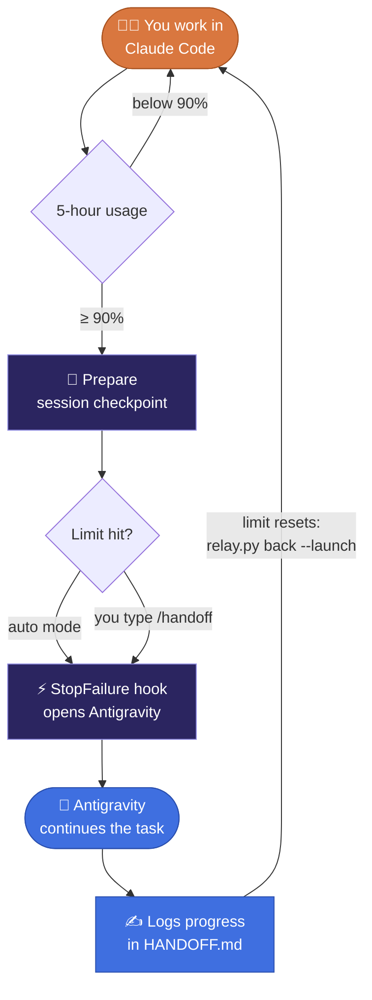
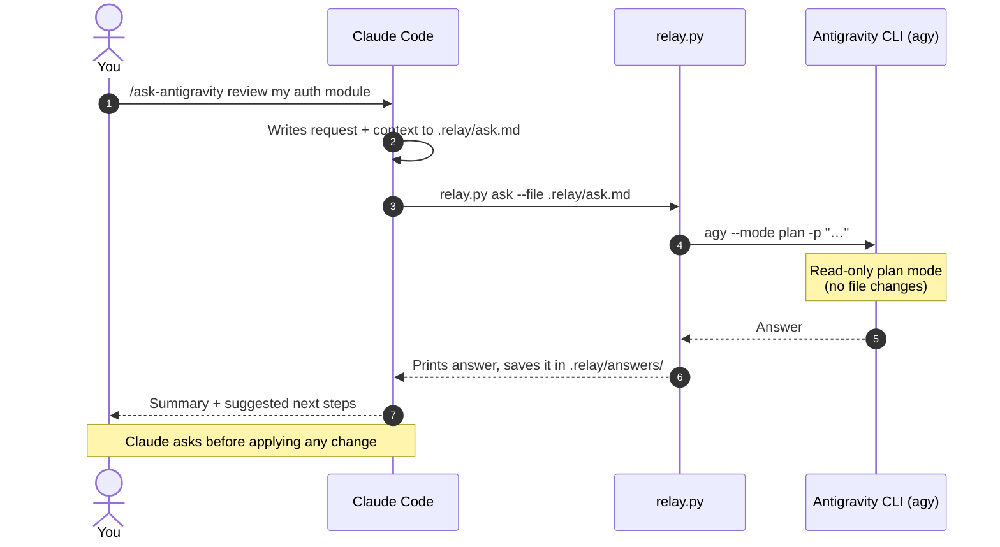
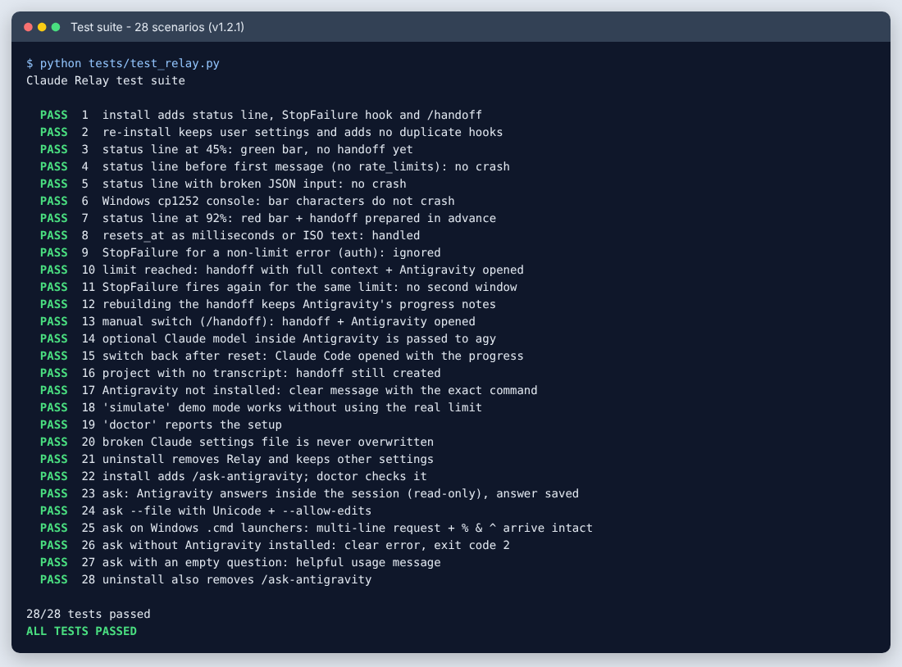

<div align="center">


<br>

<a href="#-quick-start"></a>
<a href="#-tested-conditions"></a>


<br>


<a href="LICENSE"></a>

<br><br>

**[🚀 Quick start](#-quick-start)** &nbsp;•&nbsp;
**[🧠 How it works](#-how-it-works)** &nbsp;•&nbsp;
**[🛠 Commands](#-commands)** &nbsp;•&nbsp;
**[📸 Screenshots](#-screenshots)** &nbsp;•&nbsp;
**[📘 Setup guide (PDF)](docs/Claude_Relay_Setup_Guide.pdf)** &nbsp;•&nbsp;
**[❓ FAQ](#-faq)**

</div>

<br>

## ✨ What is Claude Relay?

Claude Pro gives Claude Code a **rolling 5-hour usage window**. When it runs out, Claude stops in the middle of your task. Opening another agent is easy. **Moving the context** (the goal, what's done, which files changed, what comes next) is the hard part. Claude Relay does that for you.

<table>
<tr>
<td width="50%" valign="top">

### 🤝 Use Antigravity *inside* Claude
Type **`/ask-antigravity <request>`** in a running Claude Code session. Claude sends the question to Google Antigravity, gets the answer back and carries on, **without leaving the session**.

Use it for a second opinion, a code review or a research sub-task. It uses **Antigravity plan mode** by default, and answers are saved to `.relay/answers/`.

</td>
<td width="50%" valign="top">

### 🔁 Switch when the limit hits
At **90%** usage, Relay writes a full **handoff file**. At **100%**, it opens Antigravity in a new window, already working on your task. You can switch automatically, or yourself with **`/handoff`**.

When the limit resets, one command hands the work **back to Claude**.

</td>
</tr>
</table>

<div align="center">

</div>

## 🌟 Features

| | Feature | Details |
|:-:|---|---|
| 🤝 | **`/ask-antigravity`** | Antigravity's headless mode, called from inside Claude Code. Runs in plan mode unless you pass `--allow-edits`. |
| 📊 | **Live usage bar** | `5h █████████░ 92%  resets 15:00`. Green, then yellow at 80%, then red at 90%. |
| 📝 | **Prepares early** | The handoff is written at 90%, while Claude can still answer. At 100% it can't. |
| ⚡ | **Automatic switch** | When the usage limit stops Claude, Antigravity opens with the task loaded and you get a desktop notification. |
| 🖐 | **Manual switch** | Type `/handoff` at any time. Claude adds its own summary first. |
| ↩️ | **Switch back** | `relay.py back --launch` reopens Claude Code with Antigravity's progress. |
| 🧩 | **Claude inside Antigravity** | Optional: continue on a Claude model in Antigravity (paid tiers). |
| 📦 | **Zero dependencies** | Python standard library only. No API keys, no passwords. |
| 🛡 | **Safe install** | Backs up your settings, never touches a broken settings file, and `uninstall` restores everything. |
| 🩺 | **`doctor` and `simulate`** | A health check, plus a demo that shows the whole switch without using up your limit. |

## 🧠 How it works



### 🤝 `/ask-antigravity`, step by step



<details>
<summary><b>🔍 Under the hood: which Claude Code / Antigravity features are used</b></summary>
<br>

| Step | What happens | Feature used |
|---|---|---|
| 1. Watch | Status line shows 5-hour usage and reset time | Claude Code **status line** JSON: `rate_limits.five_hour.used_percentage`, `resets_at` (Pro/Max plans) |
| 2. Prepare | At 90%, a session checkpoint is written in advance | Session transcript (`~/.claude/projects/*.jsonl`) and `git` |
| 3a. Auto switch | Limit hit → checkpoint refreshed → an Antigravity launch is requested | Claude Code **`StopFailure` hook**, matcher `rate_limit` |
| 3b. Manual switch | `/handoff` → Claude adds a summary → Antigravity opens | Claude Code **custom slash command** |
| 4. Continue | Antigravity reads the handoff first and logs progress in it | The launch prompt identifies the selected checkpoint |
| 5. Switch back | `relay.py back --launch` → Claude Code opens with the progress | `claude "<prompt>"` |
| ★ Ask | `/ask-antigravity` → temporary request file → `agy --mode plan -p …` → answer back in Claude | Slash command + Antigravity **headless mode** (`-p`) |

`StopFailure` can fire several times for one limit, so Relay suppresses duplicate launch requests for **15 minutes per project and Claude session**. A failed launch request can be retried immediately.

</details>

## 🚀 Quick start

> [!IMPORTANT]
> **You need:** Python 3.8+ · [Claude Code](https://code.claude.com) signed in with **Claude Pro or Max** (only subscription plans send 5-hour usage data) · Antigravity CLI (`agy`) installed and signed in · git *(optional)*

**1️⃣ Get the code**

```bash
git clone https://github.com/CodeWidKrish/claude-relay.git
cd claude-relay
```

**2️⃣ Check your system and run the tests**

```bash
python relay.py doctor
python tests/test_relay.py
python tests/test_regressions.py
```

**3️⃣ Install into Claude Code**

```bash
python relay.py install --mode auto --threshold 90
python relay.py doctor          # ✅ All good
```

**4️⃣ Restart Claude Code.** You're done. 🎉

> [!TIP]
> **Windows:** keep the folder in a path **without spaces** and outside OneDrive (for example `C:\claude-relay`). If `python` isn't found, use `py`.

<details>
<summary><b>🎬 Try the whole switch without using up your limit</b></summary>
<br>

```bash
cd path/to/any/project
python /path/to/claude-relay/relay.py simulate          # dry run: prints what would happen
python /path/to/claude-relay/relay.py simulate --live   # really opens Antigravity
```

</details>

## 🎮 Usage

| You want to… | Do this |
|---|---|
| 🤝 Ask Antigravity without leaving Claude | **`/ask-antigravity <your question>`** in Claude Code, or `python relay.py ask "<question>"` |
| 📊 See how much of the 5-hour limit is left | Look at the Claude Code status line |
| 🖐 Switch to Antigravity now | **`/handoff`** in Claude Code, or `python relay.py handoff --launch` |
| ⚡ Switch automatically | Nothing to do: auto mode switches when the limit is hit |
| ↩️ Come back after the reset | `python relay.py back --launch` (inside the project folder) |
| 📜 See what happened | `python relay.py status` |
| 🧹 Remove Relay | `python relay.py uninstall` |

## 🛠 Commands

| Command | What it does |
|---|---|
| `install [--mode auto\|manual] [--threshold 90] [--model "<name>"]` | Adds the status line, `StopFailure` hook, `/handoff` and `/ask-antigravity` to Claude Code |
| `doctor` | Checks Python, `claude`, `agy`, git and the installation |
| `ask "<question>" \| --file F [--allow-edits] [--timeout 600]` | Asks Antigravity in headless mode and prints the answer |
| `handoff [--launch] [--cwd DIR] [--session ID]` | Writes a checkpoint and optionally requests an Antigravity launch |
| `launch [--cwd DIR] [--session ID]` | Requests an Antigravity launch with the selected checkpoint |
| `back [--launch] [--cwd DIR] [--session ID] [--resume]` | Updates the selected checkpoint and optionally starts or resumes Claude Code |
| `checkpoints [--cwd DIR]` | Lists checkpoint paths and session IDs |
| `preview [--cwd DIR] [--session ID]` | Shows what the selected checkpoint contains |
| `purge-answers --older-than-days N [--cwd DIR]` | Removes saved answers older than N days |
| `simulate [--live] [--cwd DIR]` | Demo: usage 45% → 85% → 92% → limit hit → switch |
| `status` | Shows config, last known usage and recent log lines |
| `uninstall` | Removes Relay and restores your previous status line |
| `statusline`, `on-limit` | Called by Claude Code (not by you) |

<details>
<summary><b>⚙️ Configuration</b> (<code>~/.claude-relay/config.json</code>)</summary>
<br>

| Key | Default | Meaning |
|---|---|---|
| `mode` | `auto` | `auto` switches when the limit is hit; `manual` only on `/handoff` |
| `warn_at` | `80` | Status line turns yellow |
| `prepare_at` | `90` | Handoff is written in advance (50–99) |
| `target_cmd` | `agy` | Antigravity CLI command |
| `target_model` | `""` | Model inside Antigravity, exactly as listed by `agy models` |
| `color` | `true` | Coloured status line (also honours `NO_COLOR`) |

Environment variables: `RELAY_DRY_RUN=1` (print instead of launching), `RELAY_HOME`, `CLAUDE_CONFIG_DIR`.

</details>

<details>
<summary><b>📝 What the handoff file contains</b></summary>
<br>

Session checkpoints are saved as Markdown under `.relay/sessions/`. Manual CLI handoffs without a session ID use `.relay/HANDOFF.md`.

- 🎯 The original goal and the 5 most recent requests
- 🛑 Last recorded agent update, including tests and next steps when captured
- 🧭 Source session, transcript availability and current Git branch
- ✅ Task list (done / in progress / pending)
- 📂 Files changed, last commands run, git status and diff stats
- ⏰ When the Claude limit resets
- 📌 Instructions for the next agent
- ✍️ **Progress since handoff**, filled in by Antigravity and kept when the handoff is rebuilt

</details>

## 📸 Screenshots

<table>
<tr>
<td width="50%" align="center"><b>🎬 Demo: the limit is hit, work moves to Antigravity</b><br><br></td>
<td width="50%" align="center"><b>🚀 Antigravity opened automatically on Windows 11</b><br><br></td>
</tr>
<tr>
<td width="50%" align="center"><b>📝 The generated handoff file</b><br><br></td>
<td width="50%" align="center"><b>⚙️ What <code>install</code> adds to Claude Code</b><br><br></td>
</tr>
<tr>
<td colspan="2" align="center"><b>Original v1.2.1 test screenshot</b><br><br></td>
</tr>
</table>

## ✅ Tested conditions

Run both test scripts for **37 scenarios**. The tests simulate Claude hook payloads and use a fake `agy` or mocked launchers.

<details>
<summary><b>🧪 Show all edge cases covered</b></summary>
<br>

| Condition | Behaviour |
|---|---|
| Windows console without UTF-8 (cp1252) | Output forced to UTF-8; never crashes |
| No usage data yet / API-key login | Shows `5h: --` and waits |
| Broken or empty JSON from Claude Code | Ignored; status line still prints |
| `StopFailure` fires repeatedly | One switch per 15 minutes |
| Non-limit errors (auth, server) | Ignored |
| `agy` not installed | Prints the exact command to run |
| No GUI terminal (SSH / WSL) | Prints the command instead of opening a window |
| No transcript (new project) | Handoff still created |
| Antigravity already wrote notes | Notes kept on rebuild |
| Invalid `settings.json` | Install stops and changes nothing |
| Re-install | No duplicate hooks; other settings kept |
| `resets_at` as seconds, milliseconds or ISO text | All handled |
| `/ask-antigravity` with Unicode, an empty question, or `agy` missing | Answer, usage message, or clear error (exit code 2) |
| `agy` installed as a Windows `.cmd` launcher | Multi-line requests and `% & ^` are passed through a file, so nothing is cut off |

</details>

> [!NOTE]
> **Historical v1.2.1 live check** Windows 11 with Python 3.14, Claude Code 2.1.221 and Antigravity CLI 1.5.9. The v1.4 test workflow runs simulated tests on Windows, macOS and Linux. Live v1.4 CLI behavior needs a signed-in smoke test.

## 🧯 Troubleshooting

<details>
<summary><b>Show common problems and fixes</b></summary>
<br>

| Problem | Fix |
|---|---|
| No usage bar in Claude Code | Restart Claude Code and send one message. It needs a **Pro/Max** login. Run `python relay.py doctor`. |
| `doctor` says FIX | Run the command it suggests, then `doctor` again |
| `agy` not found | Install the Antigravity CLI and open a **new** terminal so PATH updates |
| Antigravity shows the setup screen | First launch only: finish setup, then run `simulate --live` again |
| Nothing happens at the limit | Check `python relay.py status` → last log lines. Make sure `mode` is `auto`. |
| Hooks don't run on Windows | Move the folder to a path without spaces (e.g. `C:\claude-relay`) and run `install` again |
| You want your old status line back | `python relay.py uninstall` |

</details>

## ❓ FAQ

<details>
<summary><b>Does this bypass Claude's limits?</b></summary>
<br>No. It moves your work to another tool you already have access to. Nothing about your Claude account changes.
</details>

<details>
<summary><b>Does it need API keys?</b></summary>
<br>No. Claude Code and Antigravity each use their own sign-in.
</details>

<details>
<summary><b>Can I use Antigravity without switching away from Claude?</b></summary>
<br>Yes: <code>/ask-antigravity &lt;request&gt;</code>. Claude sends the request to Antigravity's headless mode (<code>agy -p</code>) and gets the answer back in the same session. Antigravity runs in <b>plan mode</b> by default, and the slash command asks Claude to confirm before applying suggestions. Antigravity controls plan-mode permissions.
</details>

<details>
<summary><b>Can Antigravity use Claude models?</b></summary>
<br>Paid Antigravity tiers offer Claude models. Set one with <code>install --model "&lt;exact name from agy models&gt;"</code>.
</details>

<details>
<summary><b>Does it work with the Antigravity IDE?</b></summary>
<br>Yes. Open the project in the IDE and ask it to continue from the checkpoint path shown by <code>python relay.py checkpoints</code>.
</details>

<details>
<summary><b>Is my code sent anywhere?</b></summary>
<br>Relay saves files locally and invokes the two signed-in clients. When the destination agent reads a handoff or receives a question, its provider may process that content and the project files it reads.
</details>

## v1.4 workflow

1. Run `python relay.py checkpoints` to see available session IDs. If multiple checkpoints exist, pass `--session ID` to select one. Use `--session manual` for the unsuffixed manual checkpoint.
2. Run `python relay.py preview --session ID` to inspect the checkpoint before sharing it. It may contain source prompts, command text, paths, and Git state. Add `.relay/` to the target project's ignore rules before using Relay there.
3. Run `python relay.py launch --session ID` to retry a failed launch or open a saved checkpoint. A launch request means Relay asked the terminal to start Antigravity. The terminal shows sign-in, model, and startup errors.
4. Use `python relay.py back --launch --session ID` for a new Claude conversation with the checkpoint. Add `--resume` to request the original Claude conversation when the installed CLI advertises `--resume`. Relay reports unsupported resume so you can choose the new-session command.
5. Run `python relay.py purge-answers --older-than-days 30` to delete old answer files. Review retained checkpoints separately. Relay removes its temporary prompt files after a headless call.

When a matching Claude transcript is missing, the checkpoint records that and includes any available local Git state. The last agent update can be incomplete if the limit hit mid-response. The target's checkpoint prompt identifies one task and includes its recorded progress.

### Upgrading from v1.2.1

Run `python relay.py install` again. Relay preserves existing slash-command files, including older copies. Use the CLI commands above if a command file is already present. If a workspace has the old `.agents/rules/relay-handoff.md` rule, remove that generated rule after reviewing its contents so it doesn't direct Antigravity to an older checkpoint.

The [v1.2.1 PDF setup guide](docs/Claude_Relay_Setup_Guide.pdf) is historical. Use this README for the current version.

## 📁 Project structure

```text
claude-relay/
├── relay.py                  # the whole tool (standard library only)
├── tests/
│   ├── test_relay.py         # 28 end-to-end and edge-case tests
│   └── sample_output.txt
├── docs/
│   ├── assets/               # animated banner, meter and footer (SVG)
│   ├── images/               # screenshots used in this README
│   └── Claude_Relay_Setup_Guide.pdf
├── README.md
└── LICENSE
```

## 👤 Author

<div align="center">

**Krish Hingu**<br>
Diploma in Computer Engineering · SBMPOC, Mumbai

<a href="https://github.com/CodeWidKrish"></a>

If Claude Relay saved your flow, please give it a ⭐

</div>


