<div align="center">



<br>

<a href="https://github.com/CodeWidKrish/claude-relay/actions/workflows/tests.yml"></a>
<a href="#-whats-new-in-v150"></a>
<a href="#-tested-conditions"></a>


<br>


<a href="LICENSE"></a>
<a href="https://github.com/CodeWidKrish/claude-relay/stargazers"></a>
<a href="https://github.com/CodeWidKrish/claude-relay/commits/main"></a>

<br><br>

**[🎬 Demo](#-see-it-in-30-seconds)** &nbsp;•&nbsp;
**[🚀 Quick start](#-quick-start)** &nbsp;•&nbsp;
**[🧠 How it works](#-how-it-works)** &nbsp;•&nbsp;
**[🛡 Security](#-security-and-privacy)** &nbsp;•&nbsp;
**[🛠 Commands](#-commands)** &nbsp;•&nbsp;
**[📸 Screenshots](#-screenshots)** &nbsp;•&nbsp;
**[❓ FAQ](#-faq)**

</div>

<br>

> [!NOTE]
> **Claude Pro gives Claude Code a rolling 5-hour usage window.** When it runs out, Claude stops in the middle of your task. Opening another agent is easy. **Moving the context** (the goal, what's done, which files changed, what comes next) is the hard part. **Claude Relay does that for you**, and brings the work back when the limit resets.

## 🎬 See it in 30 seconds

<div align="center">
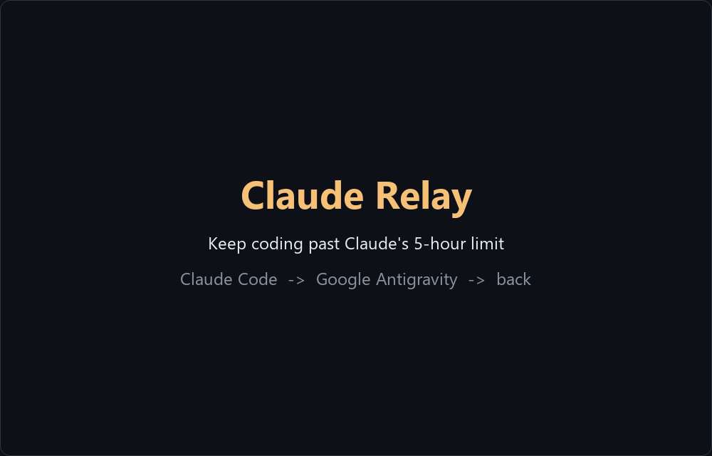

<sub>Real <code>relay.py</code> output from Windows 11 with Claude Code 2.1.221 and Antigravity CLI 1.5.10, replayed as an animation. The demo project is synthetic. Launches are dry runs, and the Antigravity answer is live.</sub>
</div>

<br>


## 💡 Why Relay?

<table>
<tr>
<th width="50%">😩 Without Relay</th>
<th width="50%">😎 With Relay</th>
</tr>
<tr>
<td valign="top">

- Claude stops mid-task at the limit, often mid-sentence
- You copy the goal, files and next steps into another agent by hand
- The other agent starts cold and redoes finished work
- Secrets you pasted go along for the ride
- When Claude is back, you explain everything again

</td>
<td valign="top">

- At **90%** a checkpoint is written while Claude can still answer
- At **100%** Antigravity opens **with the task already loaded**
- It reads the goal, task list, last update **and the diff itself**
- Keys and tokens are masked as **`[REDACTED]`**
- **`back --launch`** returns the work with every commit and file changed

</td>
</tr>
</table>

<table>
<tr>
<td width="50%" valign="top">

### 🤝 Use Antigravity *inside* Claude
Type **`/ask-antigravity <request>`** in a running Claude Code session. Claude sends the question to Google Antigravity, gets the answer back and carries on, **without leaving the session**.

Use it for a second opinion, a code review or a research sub-task. It runs in **Antigravity plan mode** by default. Files you name are attached for it, and answers are saved to `.relay/answers/`.

</td>
<td width="50%" valign="top">

### 🔁 Switch when the limit hits
At **90%** usage, Relay writes a full **handoff file**. At **100%**, it opens Antigravity in a new window, already working on your task. Switch automatically, or yourself with **`/handoff`**.

When the limit resets, one command hands the work **back to Claude**, with a summary of what changed.

</td>
</tr>
</table>

<div align="center">

</div>

## 🌟 Features

| | Feature | Details |
|:-:|---|---|
| 🤝 | **`/ask-antigravity`** | Antigravity's headless mode, called from inside Claude Code. Plan mode unless you pass `--allow-edits`. Files named in the question are attached, and Relay retries once if a tool is denied. |
| 📊 | **Live usage bar** | `5h █████████░ 92%  resets 15:00`. Green, then yellow at 80%, then red at 90%. |
| 📝 | **Prepares early** | The handoff is written at 90%, while Claude can still answer. At 100% it can't. |
| ⚡ | **Automatic switch** | When the usage limit stops Claude, Antigravity opens with the task loaded and you get a desktop notification. |
| 🖐 | **Manual switch** | Type `/handoff` at any time. Claude adds its own summary first. |
| ↩️ | **Switch back** | `relay.py back --launch` reopens Claude Code with Antigravity's notes, plus the commits and files changed since the handoff. |
| 🔐 | **Secret redaction** | Keys, tokens and passwords are masked in every checkpoint and in attached files. |
| 🧾 | **Diff in the checkpoint** | The next agent sees the uncommitted code itself, not just the file names. |
| 🙈 | **Never committed** | `.relay/` writes its own `.gitignore`, so checkpoints and answers stay out of git. |
| 📊 | **`status` and `config`** | Usage, reset countdown and checkpoints in one view. Change settings without reinstalling. |
| 🧩 | **Claude inside Antigravity** | Optional: continue on a Claude model in Antigravity (paid tiers). |
| 📦 | **Zero dependencies** | One Python file, standard library only. No API keys, no passwords. |
| 🛡 | **Safe install** | Backs up your settings, never touches a broken settings file, and `uninstall` restores everything. |
| 🩺 | **`doctor` and `simulate`** | A health check, plus a demo that shows the whole switch without using up your limit. |

## 🆕 What's new in v1.5.0

| | Feature | What you get |
|:-:|---|---|
| 🔐 | **Secret redaction** | API keys, GitHub and AWS tokens, JWTs, bearer tokens, private keys, passwords in URLs and `NAME=value` secrets are masked as `[REDACTED]` before a checkpoint is written. Normal text such as `max_tokens=1024` is left alone. Turn it off with `relay.py config redact off`. |
| 🧾 | **The code, not just the file names** | Each checkpoint includes an excerpt of the uncommitted diff (200 lines by default, set with `diff_lines`) and the git commit it started from. |
| ↩️ | **What changed while you were away** | `back` lists the commits, changed files and new untracked files since the handoff, prints them, and adds them to the checkpoint. Claude Code then starts with that summary. |
| 📎 | **Dependable `/ask-antigravity`** | Relay reads the project files named in your question and attaches them, so Antigravity can answer without tools that headless mode can't approve. If a tool is still denied, Relay retries once without tools. `.env` files, keys, credentials, large files and files outside the project are never attached, and attached text is redacted. |
| 📊 | **A readable `status`** | A usage bar, a countdown to the reset, and "Claude is available again" once it has reset. It also lists this project's checkpoints and recent activity. `--json` keeps the machine-readable output. |
| ⚙️ | **`relay.py config`** | Read or change any setting without reinstalling, with validation (for example, `prepare_at` must be 50–99 and above `warn_at`). |
| 🧪 | **54 tests**, up from 47 | They cover redaction, diff excerpts, the return summary, status, config, file attachment and the retry. |

<details>
<summary><b>📜 Earlier releases (v1.4.1 – v1.4.3)</b></summary>
<br>

**v1.4.3.** A live run against the real Antigravity CLI found a silent failure, and this release fixed it with other review findings.

- `/ask-antigravity` no longer returns a silent empty answer. In headless plan mode, `agy` auto-denies shell commands and used to exit 0 with no output. Relay now reports that as an error with Antigravity's reason.
- `.relay/` ignores itself in git. The first write creates `.relay/.gitignore` containing `*`; your own `.gitignore` is never touched.
- The handoff instructions point at sections that exist.
- An unexpanded `${CLAUDE_SESSION_ID}` is ignored with a warning.
- Early checkpoints work when Claude Code sends no reset time (once per 5-hour window).
- Session locks are always released, even after an error.
- `doctor` warns about install paths with spaces or inside OneDrive.
- 47 tests that ignore `RELAY_*` and `CLAUDE_CONFIG_DIR` set in your shell.

**v1.4.2.**
- `simulate` uses a temporary workspace and temporary Relay state.
- Dry-run launches leave the real launch cooldown available.
- Transcripts are streamed one record at a time, with malformed records skipped.

**v1.4.1.**
- `back --launch` works with Windows short paths and macOS temporary-directory aliases.
- Python 3.8 is covered in CI.

</details>

## 🧠 How it works

<div align="center">
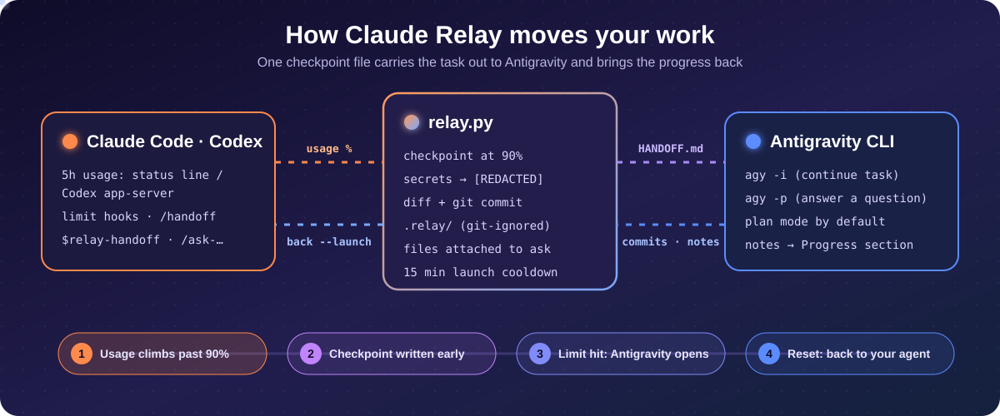
</div>

### 🔁 The full journey

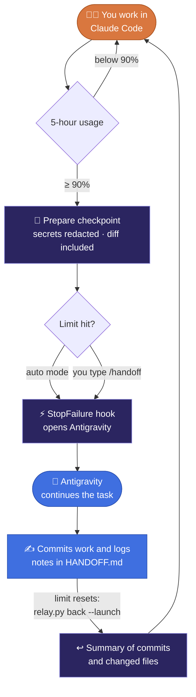

### 🗂 Life of a checkpoint

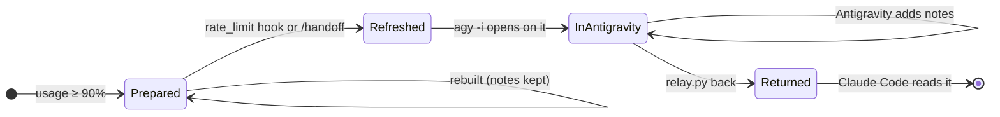

### 🤝 `/ask-antigravity`, step by step

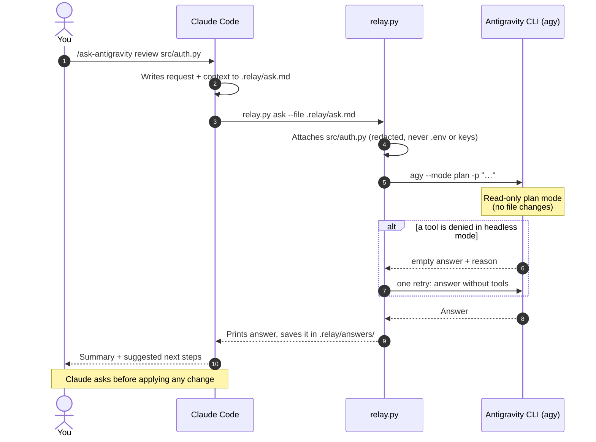

<details>
<summary><b>🔍 Under the hood: which Claude Code / Antigravity features are used</b></summary>
<br>

| Step | What happens | Feature used |
|---|---|---|
| 1. Watch | Status line shows 5-hour usage and reset time | Claude Code **status line** JSON: `rate_limits.five_hour.used_percentage`, `resets_at` (Pro/Max plans) |
| 2. Prepare | At 90%, a session checkpoint is written in advance | Session transcript (`~/.claude/projects/*.jsonl`) and `git` |
| 3a. Auto switch | Limit hit → checkpoint refreshed → an Antigravity launch is requested | Claude Code **`StopFailure` hook**, matcher `rate_limit` |
| 3b. Manual switch | `/handoff` → Claude adds a summary → Antigravity opens | Claude Code **custom slash command** |
| 4. Continue | Antigravity reads the handoff first and logs progress in it | `agy -i "<prompt>"` with the selected checkpoint |
| 5. Switch back | `relay.py back --launch` → Claude Code opens with the progress and a change summary | `git log` / `git diff --stat` since the handoff commit, then `claude "<prompt>"` |
| ★ Ask | `/ask-antigravity` → request file → files attached → `agy --mode plan -p …` → answer back in Claude | Slash command + Antigravity **headless mode** (`-p`) |

`StopFailure` can fire several times for one limit, so Relay suppresses duplicate launch requests for **15 minutes per project and Claude session**. A failed launch request can be retried immediately.

</details>

## 🚀 Quick start

> [!IMPORTANT]
> **You need:** Python 3.8+ · [Claude Code](https://code.claude.com) signed in with **Claude Pro or Max** (only subscription plans send 5-hour usage data) · Antigravity CLI (`agy`) installed and signed in · git *(optional, for diffs and the return summary)*

**1️⃣ Get the code**

```bash
git clone https://github.com/CodeWidKrish/claude-relay.git
cd claude-relay
```

**2️⃣ Check your system and run the tests**

```bash
python relay.py doctor
python tests/test_relay.py
python tests/test_regressions.py
```

**3️⃣ Install into Claude Code**

```bash
python relay.py install --mode auto --threshold 90
python relay.py doctor          # ✅ All good
```

**4️⃣ Restart Claude Code.** You're done. 🎉

> [!TIP]
> **Windows:** keep the folder in a path **without spaces** and outside OneDrive (for example `C:\claude-relay`). `doctor` warns you if it isn't. If `python` isn't found, use `py`.

<details>
<summary><b>🎬 Try the whole switch without using up your limit</b></summary>
<br>

```bash
cd path/to/any/project
python /path/to/claude-relay/relay.py simulate          # dry run in a temporary workspace
python /path/to/claude-relay/relay.py simulate --live   # really opens Antigravity
```

</details>

## 🎮 Usage

| You want to… | Do this |
|---|---|
| 🤝 Ask Antigravity without leaving Claude | **`/ask-antigravity <your question>`** in Claude Code, or `python relay.py ask "<question>"` |
| 📊 See how much of the 5-hour limit is left | Look at the Claude Code status line, or run `python relay.py status` |
| 🖐 Switch to Antigravity now | **`/handoff`** in Claude Code, or `python relay.py handoff --launch` |
| ⚡ Switch automatically | Nothing to do: auto mode switches when the limit is hit |
| ↩️ Come back after the reset | `python relay.py back --launch` (inside the project folder) |
| ⚙️ Change a setting | `python relay.py config prepare_at 85` (run `config` alone to list them) |
| 🧹 Remove Relay | `python relay.py uninstall` |

## 🛡 Security and privacy

| | Protection | How |
|:-:|---|---|
| 🔐 | **Secrets masked** | 10 patterns: private keys, `sk-` keys, GitHub and Slack tokens, AWS and Google keys, JWTs, bearer tokens, passwords in URLs, and `NAME=value` where the name ends in password, secret, token or key |
| 🙈 | **Out of git** | `.relay/.gitignore` is created on the first write |
| 🚫 | **Never attached to a question** | `.env*`, `*.pem`, `*.key`, `id_rsa*`, credentials and secrets files, files over 40 KB, and anything outside the project |
| 👀 | **Plan mode by default** | `/ask-antigravity` is read-only unless you pass `--allow-edits`, and Claude asks before applying a suggestion |
| 🧹 | **Clean up** | `purge-answers --older-than-days N` deletes old answers; temporary prompt files are removed after each call |
| 🛡 | **Settings safety** | Install backs up your status line, refuses a broken `settings.json`, and `uninstall` restores it |

> [!WARNING]
> Redaction is pattern-based. It catches common credential formats, not every possible secret. Run `python relay.py preview` before sharing a checkpoint you're unsure about.

## 🛠 Commands

| Command | What it does |
|---|---|
| `install [--mode auto\|manual] [--threshold 90] [--model "<name>"]` | Adds the status line, `StopFailure` hook, `/handoff` and `/ask-antigravity` to Claude Code |
| `doctor` | Checks Python, `claude`, `agy`, git, the install path and the installation |
| `ask "<question>" \| --file F [--allow-edits] [--timeout 600]` | Asks Antigravity in headless mode, with named files attached, and prints the answer |
| `handoff [--launch] [--cwd DIR] [--session ID]` | Writes a checkpoint and optionally requests an Antigravity launch |
| `launch [--cwd DIR] [--session ID]` | Requests an Antigravity launch with the selected checkpoint |
| `back [--launch] [--cwd DIR] [--session ID] [--resume]` | Records what changed since the handoff and optionally starts or resumes Claude Code |
| `checkpoints [--cwd DIR]` | Lists checkpoint paths and session IDs |
| `preview [--cwd DIR] [--session ID]` | Shows what the selected checkpoint contains |
| `status [--json] [--cwd DIR]` | Shows usage, the reset countdown, this project's checkpoints and recent activity |
| `config [KEY [VALUE]]` | Lists settings, prints one, or validates and saves a new value |
| `purge-answers --older-than-days N [--cwd DIR]` | Removes saved answers older than N days |
| `simulate [--live] [--cwd DIR]` | Exercises the usage threshold and limit hook in a temporary workspace by default. `--live` uses the selected workspace and can open Antigravity. |
| `uninstall` | Removes Relay and restores your previous status line |
| `statusline`, `on-limit` | Called by Claude Code (not by you) |

<details>
<summary><b>⚙️ Configuration</b> (<code>~/.claude-relay/config.json</code>)</summary>
<br>

| Key | Default | Meaning |
|---|---|---|
| `mode` | `auto` | `auto` switches when the limit is hit; `manual` only on `/handoff` |
| `warn_at` | `80` | Status line turns yellow |
| `prepare_at` | `90` | Handoff is written in advance (50–99) |
| `target_cmd` | `agy` | Antigravity CLI command |
| `target_model` | `""` | Model inside Antigravity, exactly as listed by `agy models` |
| `color` | `true` | Coloured status line (also honours `NO_COLOR`) |
| `redact` | `true` | Mask keys, tokens and passwords in checkpoints and in files attached to `ask` |
| `diff_lines` | `200` | Lines of uncommitted diff copied into a checkpoint (`0` turns it off) |

Change any of these with `python relay.py config KEY VALUE`. Environment variables: `RELAY_DRY_RUN=1` (print instead of launching), `RELAY_HOME`, `CLAUDE_CONFIG_DIR`.

</details>

<details>
<summary><b>📝 What the handoff file contains</b></summary>
<br>

Session checkpoints are saved as Markdown under `.relay/sessions/`. Manual CLI handoffs without a session ID use `.relay/HANDOFF.md`.

- 🎯 The original goal and the 5 most recent requests
- 🛑 Last recorded agent update, including tests and next steps when captured
- 🧭 Source session, transcript availability and current Git branch
- ✅ Task list (done / in progress / pending)
- 📂 Files changed, last commands run, git status and diff stats
- 🧾 An excerpt of the uncommitted diff and the commit the handoff started from
- 🔐 Keys, tokens and passwords masked as `[REDACTED]`
- ⏰ When the Claude limit resets
- 📌 Instructions for the next agent
- ✍️ **Progress since handoff**, filled in by Antigravity and kept when the handoff is rebuilt
- ↩️ **Returned to Claude Code**, added by `back`: commits, changed files and new files since the handoff

</details>

## 📸 Screenshots

<sub>All captures are real <code>relay.py</code> output on Windows 11 with Claude Code 2.1.221 and Antigravity CLI 1.5.10. The demo project and its "API key" are fake. Relay used a temporary <code>CLAUDE_CONFIG_DIR</code> and <code>RELAY_HOME</code>, and home-folder paths are shortened to <code>%TEMP%</code>. Launches are dry runs that print the exact command. The commit shown by <code>back</code> was made with plain <code>git</code> to stand in for Antigravity's work. The <code>/ask-antigravity</code> answer is a live response.</sub>

<table>
<tr>
<td width="50%" valign="top" align="center">
<b>🩺 Check your setup</b><br><br>
<a href="docs/images/v1.5.0-doctor.png">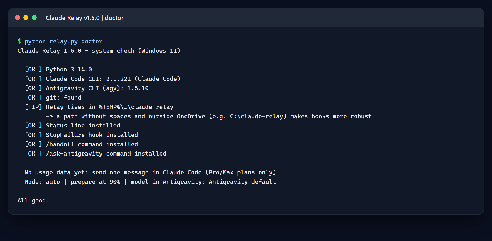</a>
</td>
<td width="50%" valign="top" align="center">
<b>⚡ From the usage bar to the automatic switch</b><br><br>
<a href="docs/images/v1.5.0-auto-switch.png">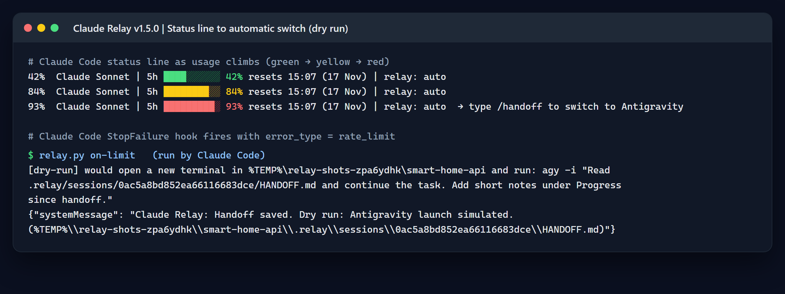</a>
</td>
</tr>
<tr>
<td width="50%" valign="top" align="center">
<b>🤝 Ask Antigravity without leaving Claude</b><br><br>
<a href="docs/images/v1.5.0-ask-antigravity.png">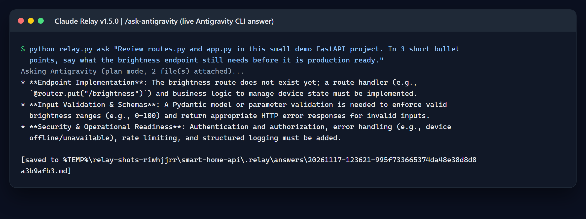</a>
</td>
<td width="50%" valign="top" align="center">
<b>↩️ Back to Claude, with what changed</b><br><br>
<a href="docs/images/v1.5.0-back.png">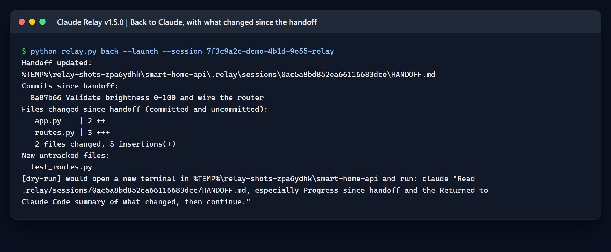</a>
</td>
</tr>
<tr>
<td width="50%" valign="top" align="center">
<b>📊 Status at a glance</b><br><br>
<a href="docs/images/v1.5.0-status.png">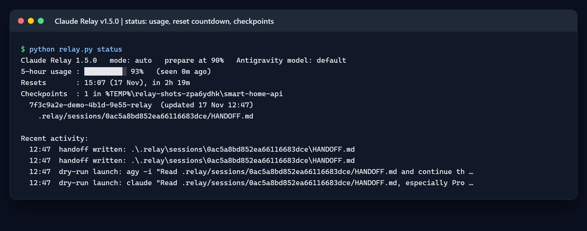</a>
</td>
<td width="50%" valign="top" align="center">
<b>⚙️ Change settings without reinstalling</b><br><br>
<a href="docs/images/v1.5.0-config.png">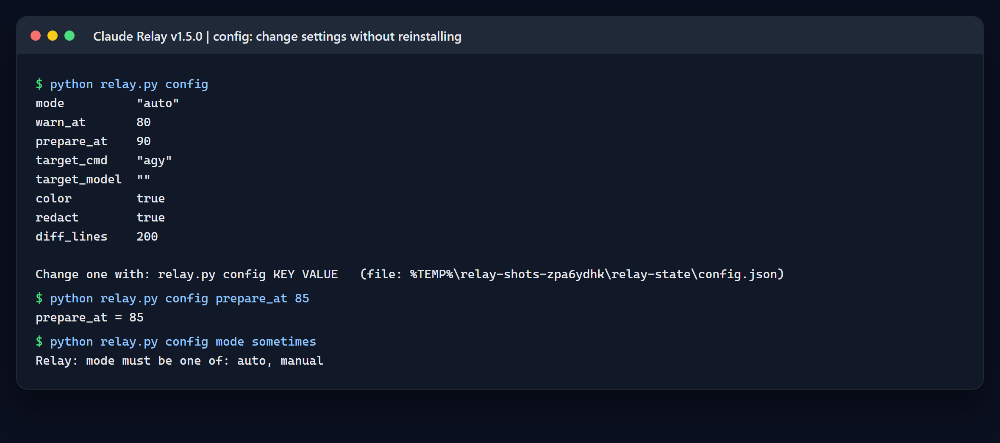</a>
</td>
</tr>
<tr>
<td colspan="2" valign="top" align="center">
<b>🙈 Checkpoints never reach git</b><br><br>
<a href="docs/images/v1.5.0-gitignore.png">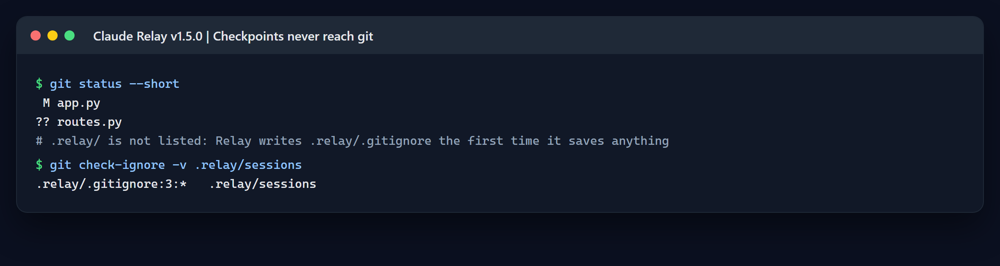</a>
</td>
</tr>
</table>

<sub>Click any screenshot to open it full size.</sub>

<details>
<summary><b>🧪 All 54 tests passing</b></summary>
<br>

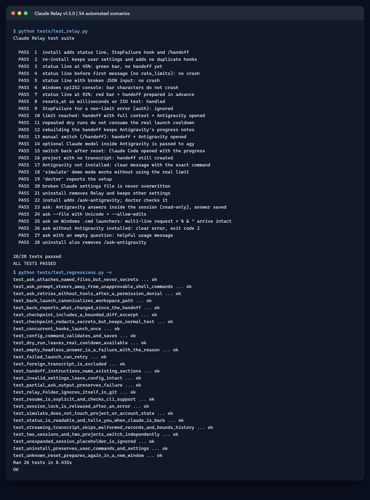

</details>

<details>
<summary><b>📄 What Antigravity reads: a full checkpoint</b></summary>
<br>

`preview` shows the exact handoff. The fake hub key in the request is already `[REDACTED]`, and the checkpoint ends with the commit it started from and the uncommitted diff itself.

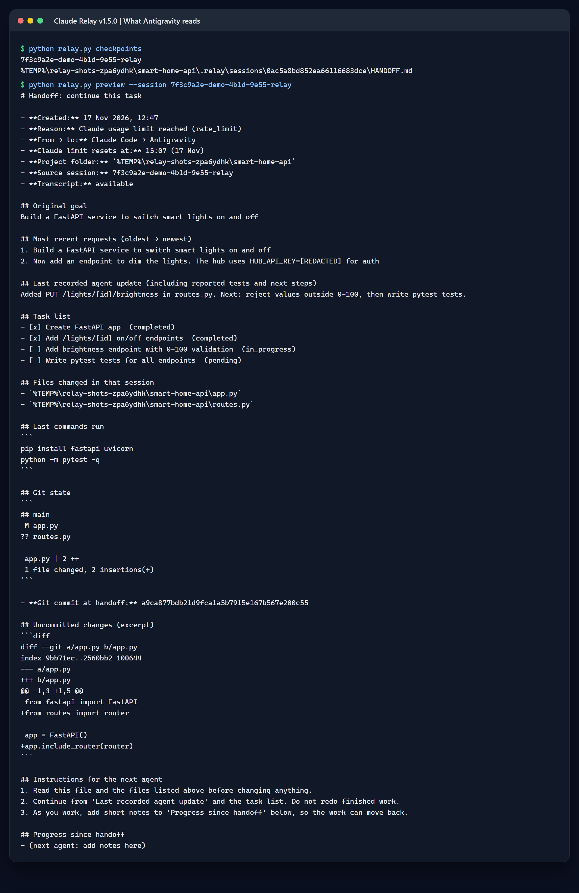

</details>

<details>
<summary>Earlier screenshots (v1.4.2 and v1.2.1)</summary>

- [v1.4.2 simulation](docs/images/v1.4.2-simulation.png)
- [v1.4.2 checkpoint preview](docs/images/v1.4.2-checkpoint.png)
- [v1.4.2 test run](docs/images/v1.4.2-tests.png)
- [Antigravity opened on Windows 11](docs/images/windows-antigravity-opened.png)
- [Claude Code settings after installation](docs/images/claude-settings.png)
- [Original simulation](docs/images/demo-simulate.png)
- [Original handoff file](docs/images/handoff-file.png)
- [Original test run](docs/images/tests-passed.png)

</details>

## ✅ Tested conditions

Run both test scripts for **54 scenarios**. The tests simulate Claude hook payloads and use a fake `agy` or mocked launchers. CI runs them on Windows, macOS and Linux, plus Python 3.8 on Ubuntu.

<details>
<summary><b>🧪 Show all edge cases covered</b></summary>
<br>

| Condition | Behaviour |
|---|---|
| Windows console without UTF-8 (cp1252) | Output forced to UTF-8; never crashes |
| No usage data yet / API-key login | Shows `5h: --` and waits |
| Broken or empty JSON from Claude Code | Ignored; status line still prints |
| `StopFailure` fires repeatedly | One switch per 15 minutes |
| Non-limit errors (auth, server) | Ignored |
| `agy` not installed | Prints the exact command to run |
| No GUI terminal (SSH / WSL) | Prints the command instead of opening a window |
| No transcript (new project) | Handoff still created |
| Antigravity already wrote notes | Notes kept on rebuild |
| Invalid `settings.json` | Install stops and changes nothing |
| Re-install | No duplicate hooks; other settings kept |
| `resets_at` as seconds, milliseconds or ISO text | All handled |
| `/ask-antigravity` with Unicode, an empty question, or `agy` missing | Answer, usage message, or clear error (exit code 2) |
| `agy` installed as a Windows `.cmd` launcher | Multi-line requests and `% & ^` are passed through a file, so nothing is cut off |
| Headless `agy` exits 0 with no answer (a tool was auto-denied) | Reported as a failure with Antigravity's reason (exit code 2) |
| Checkpoint or answer written to a git project | `.relay/.gitignore` is created, so nothing is committed |
| `/handoff` runs with an unexpanded `${CLAUDE_SESSION_ID}` | Ignored with a warning; the manual checkpoint is used |
| Usage data without `resets_at` | The early checkpoint is prepared once per 5-hour window |
| An error inside a locked section | The session lock is still released |
| `RELAY_*` or `CLAUDE_CONFIG_DIR` set in your shell | The tests still use only temporary folders |
| Keys, tokens or passwords in prompts, commands or the diff | Masked as `[REDACTED]`; `max_tokens=1024` and other plain numbers are kept |
| A large uncommitted diff | Cut to `diff_lines`, with a note to run `git diff` for the rest |
| Commits and new files made after the handoff | Listed by `back` and added to the checkpoint |
| A question naming `.env`, key files, big files or files outside the project | Never attached; only safe, small project files are |
| Antigravity is denied a tool in headless mode | One retry that asks for an answer without tools |
| An invalid `config` value | Rejected with the allowed range; nothing is saved |

</details>

> [!NOTE]
> **v1.5.0 live check:** Windows 11, Python 3.14, Claude Code 2.1.221 and Antigravity CLI 1.5.10. `doctor` and three live `ask` calls to Antigravity, all answered, were run against the real CLIs. The automatic switch and the return trip were run as dry runs, so the full signed-in round trip still needs the [smoke test](#live-round-trip-smoke-test) below.

## 🧯 Troubleshooting

<details>
<summary><b>Show common problems and fixes</b></summary>
<br>

| Problem | Fix |
|---|---|
| No usage bar in Claude Code | Restart Claude Code and send one message. It needs a **Pro/Max** login. Run `python relay.py doctor`. |
| `doctor` says FIX | Run the command it suggests, then `doctor` again |
| `agy` not found | Install the Antigravity CLI and open a **new** terminal so PATH updates |
| Antigravity shows the setup screen | First launch only: finish setup, then run `simulate --live` again |
| `ask` says Antigravity returned an empty answer | Name the files you mean in the question (for example `src/app.py`) so Relay attaches them |
| Nothing happens at the limit | Run `python relay.py status` and check recent activity. Make sure `mode` is `auto`. |
| Hooks don't run on Windows | Move the folder to a path without spaces (e.g. `C:\claude-relay`) and run `install` again |
| You want your old status line back | `python relay.py uninstall` |

</details>

## ❓ FAQ

<details>
<summary><b>Does this bypass Claude's limits?</b></summary>
<br>No. It moves your work to another tool you already have access to. Nothing about your Claude account changes.
</details>

<details>
<summary><b>Does it need API keys?</b></summary>
<br>No. Claude Code and Antigravity each use their own sign-in.
</details>

<details>
<summary><b>Can I use Antigravity without switching away from Claude?</b></summary>
<br>Yes: <code>/ask-antigravity &lt;request&gt;</code>. Claude sends the request to Antigravity's headless mode (<code>agy -p</code>) and gets the answer back in the same session. Antigravity runs in <b>plan mode</b> by default, and the slash command asks Claude to confirm before applying suggestions.
</details>

<details>
<summary><b>Can Antigravity use Claude models?</b></summary>
<br>Paid Antigravity tiers offer Claude models. Set one with <code>install --model "&lt;exact name from agy models&gt;"</code> or <code>config target_model "&lt;name&gt;"</code>.
</details>

<details>
<summary><b>Does it work with the Antigravity IDE?</b></summary>
<br>Yes. Open the project in the IDE and ask it to continue from the checkpoint path shown by <code>python relay.py checkpoints</code>.
</details>

<details>
<summary><b>Is my code sent anywhere?</b></summary>
<br>Relay saves files locally and invokes the two signed-in clients. It masks common secrets in checkpoints and never attaches <code>.env</code> or key files to a question. When the destination agent reads a handoff or receives a question, its provider may process that content and the project files it reads.
</details>

## 🧭 Advanced workflow

1. Run `python relay.py checkpoints` to see available session IDs. If multiple checkpoints exist, pass `--session ID` to select one. Use `--session manual` for the unsuffixed manual checkpoint.
2. Run `python relay.py preview --session ID` to inspect the checkpoint before sharing it.
3. Run `python relay.py launch --session ID` to retry a failed launch or open a saved checkpoint. The terminal shows sign-in, model, and startup errors.
4. Use `python relay.py back --launch --session ID` for a new Claude conversation with the checkpoint. Add `--resume` to reopen the original Claude conversation when your installed CLI supports it.
5. Run `python relay.py purge-answers --older-than-days 30` to delete old answer files.

When a matching Claude transcript is missing, the checkpoint records that and includes any available local Git state. The last agent update can be incomplete if the limit hit mid-response.

```bash
python relay.py checkpoints
python relay.py preview --session SESSION_ID
python relay.py launch --session SESSION_ID
python relay.py back --launch --session SESSION_ID
```

### Live round-trip smoke test

- In a disposable Git project, sign in to both CLIs and run `python relay.py doctor`. Record the operating system and CLI versions.
- Start a Claude Code session with a small task, then run `/handoff`. Confirm Antigravity opens in the intended workspace, reads the correct checkpoint, and records its progress there.
- Run `python relay.py checkpoints` to find the source session. Run `python relay.py back --launch --session SESSION_ID --resume` and confirm Claude reopens that conversation and reads Antigravity's progress and the change summary. If your CLI lacks resume support, omit `--resume`.
- To verify automatic handoff, repeat when a real usage-limit event occurs and confirm that one Antigravity window opens for the affected session.

<details>
<summary><b>Upgrading from v1.2.1</b></summary>
<br>

Run `python relay.py install` again. Relay preserves existing slash-command files, including older copies. If a workspace has the old `.agents/rules/relay-handoff.md` rule, remove that generated rule after reviewing its contents so it doesn't direct Antigravity to an older checkpoint. The [v1.2.1 PDF setup guide](docs/Claude_Relay_Setup_Guide.pdf) is historical; use this README for the current version.

</details>

## 🗺 Roadmap

- [x] Automatic switch at the limit, manual `/handoff`, and return with `back`
- [x] `/ask-antigravity` from inside Claude Code
- [x] Secret redaction, diff excerpts and the "what changed" summary
- [x] `status`, `config`, `doctor` and `simulate`
- [ ] Recorded live round trip with both CLIs signed in
- [ ] One-command install (`pipx install` / `uv tool install`)
- [ ] Tagged GitHub releases with a changelog

## 📁 Project structure

```text
claude-relay/
├── relay.py                  # the whole tool (standard library only)
├── tests/
│   ├── test_relay.py         # 28 end-to-end and edge-case tests
│   ├── test_regressions.py   # 26 regression tests (sessions, locks, installs, ask, redaction, return)
│   └── sample_output.txt
├── docs/
│   ├── assets/               # banner, demo GIF, architecture, stats, meter and footer
│   ├── images/               # screenshots used in this README
│   └── Claude_Relay_Setup_Guide.pdf
├── .github/workflows/tests.yml
├── README.md
└── LICENSE
```

## ⭐ Star history

<div align="center">
<a href="https://star-history.com/#CodeWidKrish/claude-relay&Date"></a>
</div>

## 👤 Author

<div align="center">

**Krish Hingu**<br>
Diploma in Computer Engineering · SBMPOC, Mumbai

<a href="https://github.com/CodeWidKrish"></a>

If Claude Relay saved your flow, please give it a ⭐

</div>


