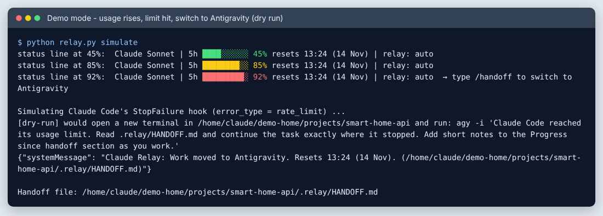
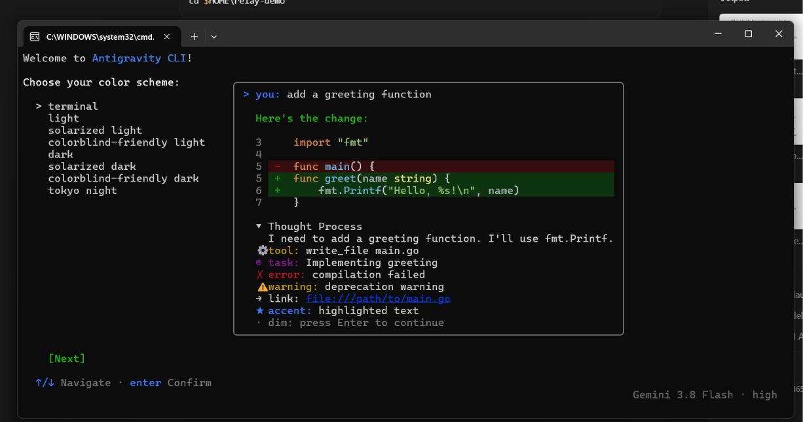
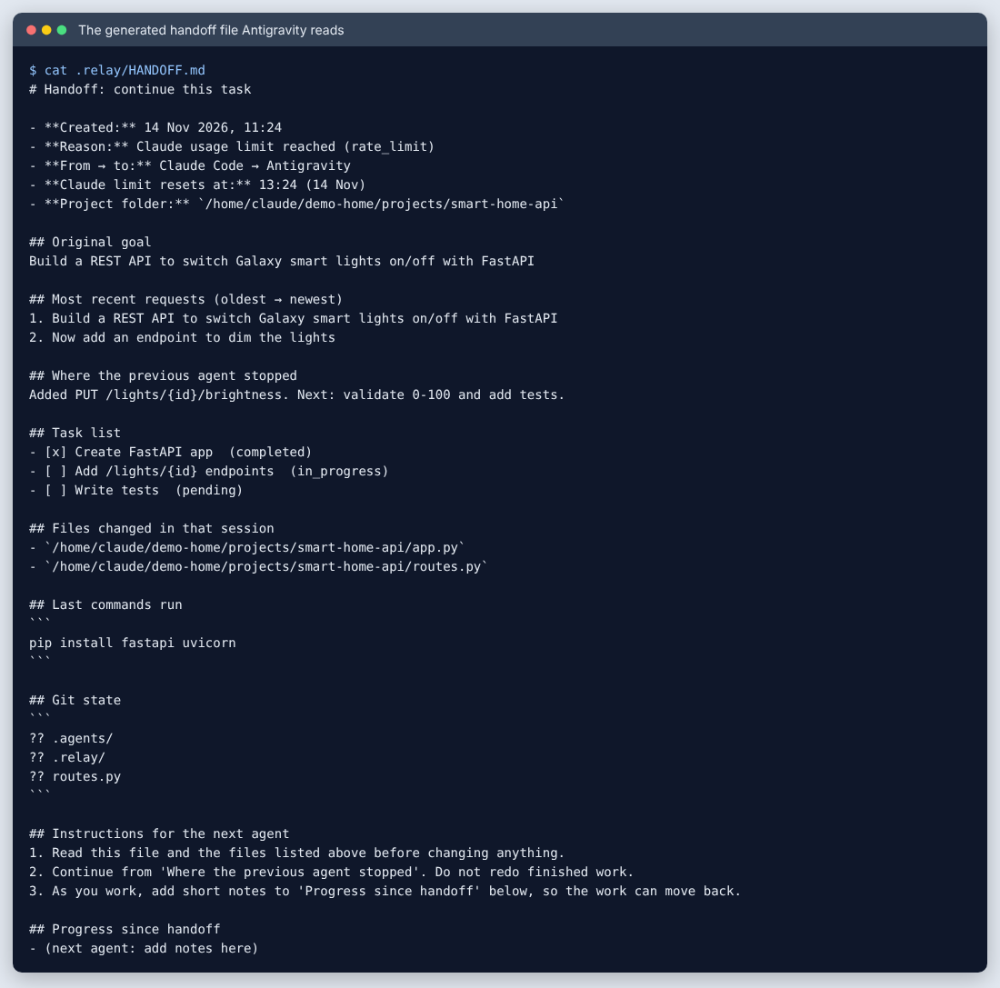
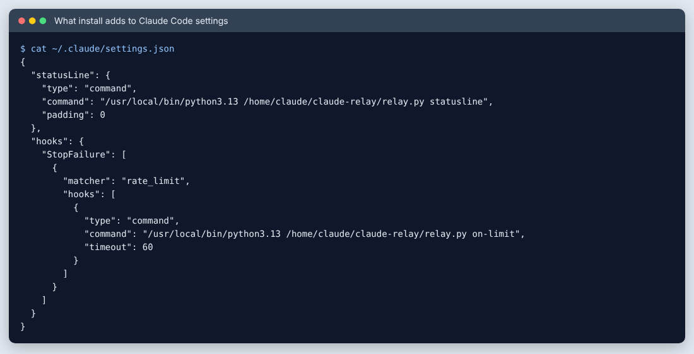
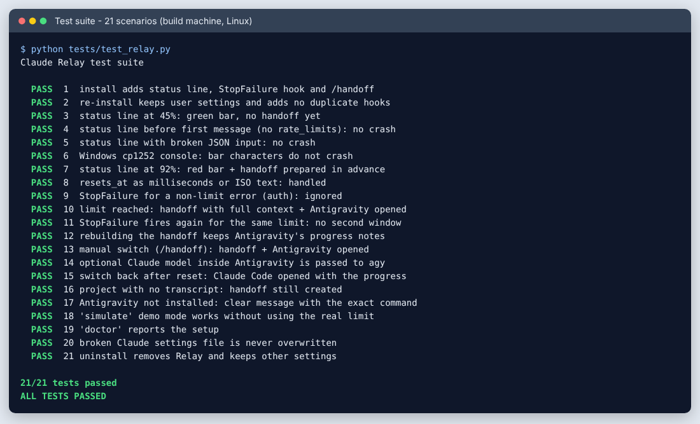

# Claude Relay

**Keep coding when Claude Code hits its 5-hour limit.**
Claude Relay hands your task from **Claude Code** to **Google Antigravity** when your Claude Pro session limit runs out, either automatically or when you type `/handoff`. It hands the work back when the limit resets.

    

```
Claude Code ──(5h limit hit  /  you type /handoff)──► .relay/HANDOFF.md ──► Antigravity (agy)
     ▲                                                                            │
     └───────────────────(limit resets: relay.py back --launch)◄──────────────────┘
```

---

## Contents
- [Why](#why)
- [Features](#features)
- [How it works](#how-it-works)
- [Quick start](#quick-start)
- [Usage](#usage)
- [Commands](#commands)
- [Configuration](#configuration)
- [What the handoff contains](#what-the-handoff-contains)
- [Screenshots](#screenshots)
- [Tested conditions](#tested-conditions)
- [Troubleshooting](#troubleshooting)
- [FAQ](#faq)
- [Limitations](#limitations)
- [Project structure](#project-structure)
- [License](#license)

---

## Why

Claude Pro gives Claude Code a **rolling 5-hour usage window**. When it's used up, Claude stops answering until the window resets, often in the middle of a task.

Opening another agent is easy. **Moving the context** is the hard part: the goal, what's done, which files changed, and what comes next. Claude Relay does this for you, so Antigravity continues the task instead of starting from zero.

## Features

- **Live usage bar** in Claude Code: `5h █████████░ 92%  resets 15:00`
- **Prepares at 90%.** The handoff is written while Claude can still answer, because at 100% it can't.
- **Automatic switch.** When the usage limit stops Claude, Antigravity opens in a new window with the task loaded, plus a desktop notification.
- **Manual switch.** Type `/handoff` in Claude Code at any time. Claude adds its own summary first.
- **Switch back.** One command reopens Claude Code with Antigravity's progress.
- **Optional:** continue on a **Claude model inside Antigravity** (paid Antigravity tiers).
- **Zero dependencies.** Python standard library only. No API keys, no passwords.
- **Safe install.** Backs up your settings, never overwrites a broken settings file, and `uninstall` restores everything.
- **`doctor`** health check and **`simulate`** demo mode (shows the switch without using up your limit).

## How it works

| Step | What happens | Feature used |
|---|---|---|
| 1. Watch | Status line shows 5-hour usage and reset time | Claude Code **status line** JSON: `rate_limits.five_hour.used_percentage`, `resets_at` (Pro/Max plans) |
| 2. Prepare | At 90%, `.relay/HANDOFF.md` is written in advance | Claude Code session transcript (`~/.claude/projects/*.jsonl`) + `git` |
| 3a. Auto switch | Usage limit hit → handoff refreshed → `agy -i "Read .relay/HANDOFF.md and continue…"` in a new window | Claude Code **`StopFailure` hook**, matcher `rate_limit` |
| 3b. Manual switch | `/handoff` → Claude adds a summary → Antigravity opens | Claude Code **custom slash command** |
| 4. Continue | Antigravity reads the handoff first and logs progress in it | Antigravity **rules**: `.agents/rules/relay-handoff.md` |
| 5. Switch back | `relay.py back --launch` → Claude Code opens with the progress | `claude "<prompt>"` |

`StopFailure` can fire several times for one limit, so Relay switches only **once per 15 minutes**.

## Quick start

**Requirements**

| Needed | Why |
|---|---|
| Python 3.8+ | Runs Relay |
| [Claude Code](https://code.claude.com), signed in with **Claude Pro or Max** | Only subscription plans send 5-hour usage data |
| Antigravity CLI (`agy`), installed and signed in | Opens Antigravity with your task |
| git *(optional)* | Adds the git state to the handoff |

**Install**

```bash
git clone https://github.com/CodeWidKrish/claude-relay.git
cd claude-relay
python relay.py install --mode auto --threshold 90
python relay.py doctor
```

Restart Claude Code. `doctor` should say **All good**.

> **Windows tip:** keep the folder in a path **without spaces** (e.g. `C:\claude-relay`), not inside OneDrive. Run the commands in PowerShell. If `python` isn't found, use `py`.

**Try it without using up your limit**

```bash
cd path/to/any/project
python /path/to/claude-relay/relay.py simulate          # dry run: prints what would happen
python /path/to/claude-relay/relay.py simulate --live   # really opens Antigravity
```

## Usage

| You want to… | Do this |
|---|---|
| See how much of the 5-hour limit is left | Look at the Claude Code status line |
| Switch to Antigravity now | Type **`/handoff`** in Claude Code, or `python relay.py handoff --launch` |
| Switch automatically | Nothing: auto mode does it when the limit is hit |
| Come back after the reset | `python relay.py back --launch` (inside the project folder) |
| See what happened | `python relay.py status` (config, last usage, log) |
| Remove Relay | `python relay.py uninstall` |

## Commands

| Command | What it does |
|---|---|
| `install [--mode auto\|manual] [--threshold 90] [--model "<name>"]` | Adds the status line, `StopFailure` hook and `/handoff` to Claude Code |
| `doctor` | Checks Python, `claude`, `agy`, git and the installation |
| `handoff [--launch] [--cwd DIR]` | Writes `.relay/HANDOFF.md` (and opens Antigravity) |
| `launch [--cwd DIR]` | Opens Antigravity on the existing handoff |
| `back [--launch] [--cwd DIR]` | Hands the work back to Claude Code |
| `simulate [--live] [--cwd DIR]` | Demo: usage 45% → 85% → 92% → limit hit → switch |
| `status` | Shows config, last known usage and recent log lines |
| `uninstall` | Removes Relay and restores your previous status line |
| `statusline`, `on-limit` | Called by Claude Code (not by you) |

## Configuration

Stored in `~/.claude-relay/config.json`:

| Key | Default | Meaning |
|---|---|---|
| `mode` | `auto` | `auto` switches when the limit is hit; `manual` only on `/handoff` |
| `warn_at` | `80` | Status line turns yellow |
| `prepare_at` | `90` | Handoff is written in advance (50–99) |
| `target_cmd` | `agy` | Antigravity CLI command |
| `target_model` | `""` | Model inside Antigravity, exactly as listed by `agy models` (e.g. a Claude model on paid tiers) |
| `color` | `true` | Coloured status line (also honours `NO_COLOR`) |

Environment variables: `RELAY_DRY_RUN=1` (print instead of launching), `RELAY_HOME`, `CLAUDE_CONFIG_DIR`.

## What the handoff contains

`.relay/HANDOFF.md` is plain Markdown, readable by people, Claude and Antigravity:

- Original goal and the 5 most recent requests
- **Where the previous agent stopped**
- Task list (done / in progress / pending)
- Files changed, last commands run, git status and diff stats
- When the Claude limit resets
- Instructions for the next agent
- **Progress since handoff**, which Antigravity fills in and which is kept when the handoff is rebuilt

## Screenshots

**Demo: usage rises, the limit is hit, the work moves to Antigravity**


**Antigravity opened automatically on Windows 11**


**The generated handoff file**


**What `install` adds to Claude Code**


**Test suite: 21/21 passing**


## Tested conditions

Run `python tests/test_relay.py`. It needs neither Claude Code nor Antigravity.

| Condition | Behaviour |
|---|---|
| Windows console without UTF-8 (cp1252) | Output forced to UTF-8; never crashes |
| No usage data yet / API-key login | Shows `5h: --` and waits |
| Broken or empty JSON from Claude Code | Ignored; status line still prints |
| `StopFailure` fires repeatedly | One switch per 15 minutes |
| Non-limit errors (auth, server) | Ignored |
| `agy` not installed | Prints the exact command to run |
| No GUI terminal (SSH / WSL) | Prints the command instead of opening a window |
| No transcript (new project) | Handoff still created |
| Antigravity already wrote notes | Notes kept on rebuild |
| Invalid `settings.json` | Install stops, changes nothing |
| Re-install | No duplicate hooks; other settings kept |
| `resets_at` as seconds, milliseconds or ISO text | All handled |

**Verified on:** Windows 11 (Python 3.14, Claude Code 2.1.221, Antigravity CLI 1.4.12) and Linux.

## Troubleshooting

| Problem | Fix |
|---|---|
| No usage bar in Claude Code | Restart Claude Code and send one message. The bar needs a **Pro/Max** login, and data appears after the first reply. Run `python relay.py doctor`. |
| `doctor` says FIX | Run the command it suggests, then `doctor` again |
| `agy` not found | Install the Antigravity CLI and open a **new** terminal so PATH updates |
| Antigravity opens the setup screen | First launch only: finish setup, then run `simulate --live` again |
| Nothing happens at the limit | Check `python relay.py status` → last log lines. Make sure `mode` is `auto`. |
| Hooks don't run on Windows | Move the folder to a path without spaces (e.g. `C:\claude-relay`) and run `install` again |
| You want your old status line back | `python relay.py uninstall` |

## FAQ

**Does this bypass Claude's limits?**
No. It moves your work to another tool you already have access to. Nothing about your Claude account changes.

**Does it need API keys?**
No. Claude Code and Antigravity each use their own sign-in.

**Can Antigravity use Claude models?**
Paid Antigravity tiers offer Claude models. Set one with `install --model "<exact name from agy models>"`.

**Does it work with the Antigravity IDE?**
Yes. The handoff rule lives in `.agents/rules/`, which the IDE also reads. Open the project in the IDE and ask it to continue.

**Is my code sent anywhere?**
No. Relay only reads local files and starts local programs.

## Limitations

- Antigravity continues the **task** from the handoff and the files, not Claude's exact chat history.
- If the limit hits in the middle of an answer, the last step may be partial. The handoff lists the changed files so they can be checked.
- `StopFailure` doesn't include the reset time, so Relay takes it from the status line.

**Roadmap:** automatic switch-back at the reset time, an automatic Claude summary at 90%, and IDE-specific launch.

## Project structure

```
claude-relay/
├── relay.py              # the whole tool (standard library only)
├── tests/
│   ├── test_relay.py     # 21 end-to-end and edge-case tests
│   └── sample_output.txt
├── docs/images/          # screenshots used in this README
├── README.md
└── LICENSE
```

## License

MIT © 2026 Krish Hingu
